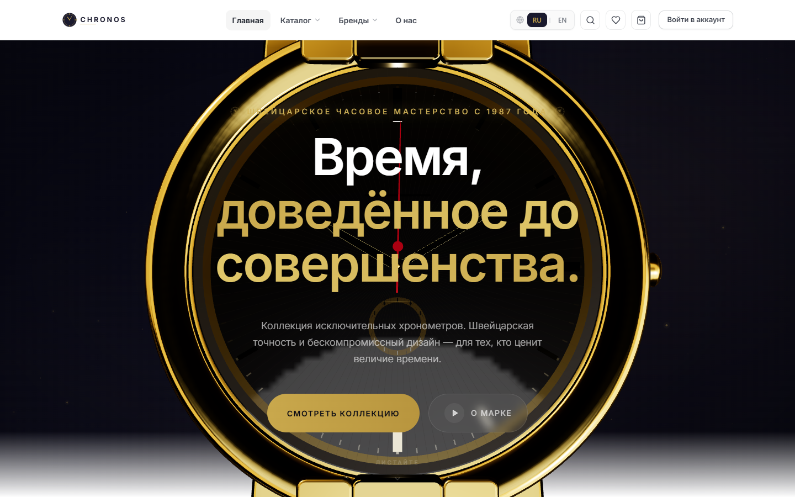

# Ravshanjon

**AI Developer · создаю сайты, приложения и автоматизацию с помощью ИИ**
*AI Developer · building websites, apps and automation with AI*

[Русский](#-русский) · [English](#-english)

---

## 🇷🇺 Русский

Я превращаю идею в работающий продукт: от лендинга до платформы с базой данных, авторизацией и админкой. Пишу код вместе с ИИ: ставлю задачу, проверяю результат и довожу проект до запуска в продакшене.

**Навыки**
- Основы C++ и Python, HTML и CSS
- Разработка с ИИ: постановка задач, ревью кода, отладка
- Деплой и запуск: GitHub, Vercel, базы данных

**ИИ-инструменты:** Claude · ChatGPT · Cursor · Antigravity

**Технологии в моих проектах:** React, Next.js, TypeScript, Three.js, Tailwind CSS, Node.js, FastAPI, PostgreSQL, Supabase, Telegram Mini Apps

## 🇬🇧 English

I turn ideas into working products, from landing pages to full platforms with a database, authentication and an admin panel. I build with AI: I define the task, review the result and ship the project to production.

**Skills**
- C++ and Python basics, HTML and CSS
- AI-assisted development: task design, code review, debugging
- Shipping: GitHub, Vercel, databases

**AI tools:** Claude · ChatGPT · Cursor · Antigravity

**Technologies in my projects:** React, Next.js, TypeScript, Three.js, Tailwind CSS, Node.js, FastAPI, PostgreSQL, Supabase, Telegram Mini Apps

---

## Проекты · Projects

> Код основных проектов закрыт. Демо открыто, доступ к коду — по запросу.
> *Source code of featured projects is private. Live demos are open; code access on request.*

<table>
<tr>
<td width="50%" valign="top">

### Chronos — 3D Watch Store

Интернет-магазин часов с интерактивной 3D-моделью, входом через Google, корзиной и избранным.
*Luxury watch store with an interactive 3D model, Google sign-in, cart and wishlist.*

`React` `Three.js` `Supabase` `Tailwind`

**[Демо / Live →](https://3dwatch-portfolio.vercel.app)** · [Подробнее / Details](https://github.com/Ravshanjon-developer/chronos-watch-store)

</td>
<td width="50%" valign="top">

### Luxura — 3D Car Landing

Концепт лендинга автодилера: кинематографичная анимация при скролле и 3D-конфигуратор цвета.
*Car dealer landing concept: cinematic scroll animation and a 3D color configurator.*

`Three.js` `GSAP` `JavaScript`

**[Демо / Live →](https://lending-3dcar.vercel.app)** · [Подробнее / Details](https://github.com/Ravshanjon-developer/luxura-car-landing)

</td>
</tr>
<tr>
<td width="50%" valign="top">

### KeyMaster — Hotkeys Learning Platform

Платформа для изучения горячих клавиш: курсы, практика, рейтинг, личный путь, RU/TJ.
*Platform for learning keyboard shortcuts: courses, practice, leaderboard, RU/TJ.*

`React` `TypeScript` `FastAPI` `PostgreSQL`

**[Демо / Live →](https://keymaster-liart.vercel.app)** · [Подробнее / Details](https://github.com/Ravshanjon-developer/keymaster-platform)

</td>
<td width="50%" valign="top">

### MarketBridge — B2C/B2B Marketplace

SaaS-платформа электронной торговли: общий каталог и склад, витрины для покупателей и компаний, кабинет продавца и админка.
*E-commerce SaaS: shared catalog and inventory, B2C and B2B storefronts, seller and admin panels.*

`Next.js` `NestJS` `Prisma` `PostgreSQL`

**[Демо / Live →](https://www.marketbridge.pp.ua)** · [Подробнее / Details](https://github.com/Ravshanjon-developer/marketbridge)

</td>
</tr>
</table>

---

**Открыт к заказам и сотрудничеству · Open to projects and collaboration**
[WhatsApp](https://wa.me/992119985098) · [Telegram](https://t.me/ravshanjonitolibjon) · [Email](mailto:ravg578@gmail.com)

